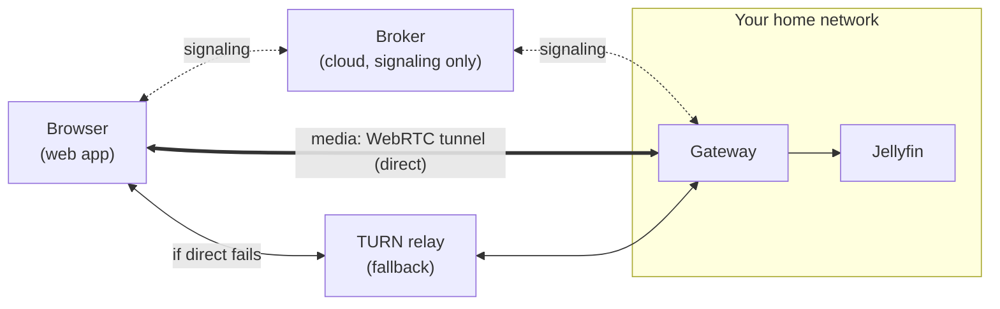

# StreamIQ

**Stream your home media from anywhere. No port forwarding, and your files never leave your hardware.**

## Why it's different

- **Zero router config.** A small gateway on your NAS or PC opens a WebRTC data-channel
  tunnel to your browser. No port forwarding, no dynamic DNS, no VPN. When a direct
  connection can't be made, a TURN relay carries the tunnel instead.
- **Private by design.** The cloud only does signaling: it introduces your browser to
  your gateway. The media goes straight from your home to the browser, end-to-end
  encrypted, and the player shows whether the connection is direct or relayed.
- **Works where you watch.** Phones on cellular, laptops, and TV browsers, with a TV mode
  for the remote's arrow keys.

## How it works

The browser and the gateway exchange connection offers through the broker; after that,
every request and media byte goes through the encrypted WebRTC tunnel between them. The
gateway forwards it to the Jellyfin server on your network, which never has to be
reachable from the internet.
